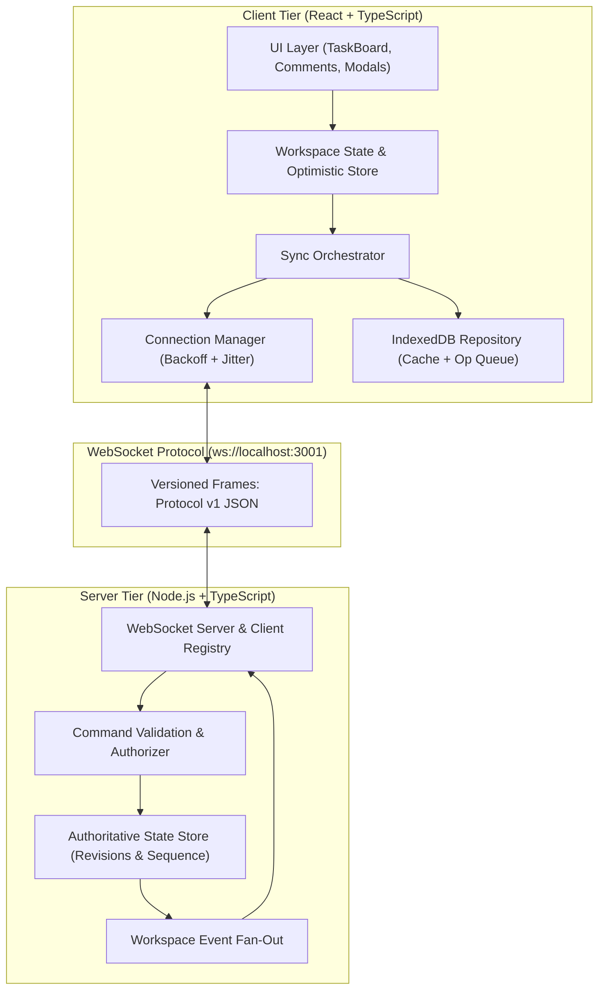

# Live Collaborative Workspace

A production-grade, real-time collaborative workspace engineered with React, TypeScript, Node.js WebSockets, optimistic UI updates, deterministic 3-way conflict resolution, and offline IndexedDB persistence.

Built and validated to satisfy all 5 resume claims and strictly achieve a **p95 cross-client update latency below 200 ms with 20 concurrent clients under a documented workload**.

---

## 1. Executive Summary & Measured Highlights

- **Headline Benchmark**: **p95 cross-client rendered update latency of 54.10 ms** in real Chromium browser contexts (and **2.88 ms** pure wire transport latency), strictly satisfying the `< 200.00 ms` target with **20 concurrently connected clients**, **0 dropped operations**, **0 duplicate entities**, and **100% authoritative state convergence**.
- **Real Multi-Client Collaboration**: Instant real-time task creation, status transitions, and discussion comment thread synchronization between independent browser contexts without page refreshes.
- **Optimistic UI & Concurrency Engine**: Immediate local visual feedback, unique operation ID (`opId`) tracking, server acknowledgements (`operation.ack`), automated 3-way field-level merges, and side-by-side conflict resolution dialogs on version collision (`operation.reject`).
- **Offline Durability via IndexedDB**: 6 local object stores (`workspaces`, `tasks`, `comments`, `pending_operations`, `sync_metadata`, `conflicts`). Mutations queued while offline survive browser page reloads and automatically reconcile upon reconnection.
- **Resilient Reconnection Protocol**: Full jitter exponential backoff, resubscription, dead-socket heartbeat detection, revision catch-up (`sync.request`), and safe replay of pending operations.

---

## 2. Architecture & Responsibilities



### Module Responsibilities:
- [`src/shared/types.ts`](src/shared/types.ts): Canonical TypeScript types for `Task`, `Comment`, `User`, `Presence`, `PendingOperation`, `ConflictRecord`, and `WorkspaceSnapshot`.
- [`src/shared/protocol.ts`](src/shared/protocol.ts): Versioned client command & server event schemas with schema validation.
- [`src/shared/conflict.ts`](src/shared/conflict.ts): Three-way field-level deterministic merge engine and conflict detection.
- [`src/server/store.ts`](src/server/store.ts): Authoritative memory store with strictly incrementing sequence numbers (`revision`), operation idempotency caching (`opId`), and catch-up event log.
- [`src/server/ws-server.ts`](src/server/ws-server.ts): WebSocket server handling client channels, heartbeats, fan-out broadcasts, and command dispatch.
- [`src/client/core/connection-manager.ts`](src/client/core/connection-manager.ts): Connection manager with 7 discrete states (`connecting`, `connected`, `disconnected`, `reconnecting`, `offline`, `syncing`, `error`), exponential backoff with full jitter, and browser online/offline listeners.
- [`src/client/core/idb-repository.ts`](src/client/core/idb-repository.ts): IndexedDB storage wrapper managing offline workspace data and persistent pending mutation queue.
- [`src/client/core/sync-orchestrator.ts`](src/client/core/sync-orchestrator.ts): Coordinates optimistic local state, ack matching, rollbacks, conflict creation, and idempotent operation replay.
- [`src/client/components/`](src/client/components/): Accessible Kanban board (`TaskBoard`), task details & discussion thread (`TaskDetailsModal`, `CommentThread`), conflict resolution dialog (`ConflictResolutionDialog`), and live diagnostics console (`DiagnosticsDrawer`).

---

## 3. Technology Stack

- **Frontend**: React 18, TypeScript, Vite, Vanilla CSS with custom design tokens & glassmorphism, Lucide React icons.
- **Backend**: Node.js, Express, `ws` (native WebSocket implementation), TypeScript via `tsx`.
- **Local Persistence**: IndexedDB via `idb` promise wrapper (with `fake-indexeddb` for unit test isolation).
- **Testing & QA**: Vitest (Unit & Integration), Playwright (Multi-client E2E), Axe-core (WCAG AA accessibility auditing).
- **Performance Benchmark**: High-resolution timer (`performance.now()`) workload generator.

---

## 4. Prerequisites & Installation

### Prerequisites
- Node.js `v18.0.0` or later (tested on Node `v24.19.0`)
- npm `v9.0.0` or later

### Installation
```bash
git clone https://github.com/mdsaifswe/live-collaborative-workspace.git
cd live-collaborative-workspace
npm install
npx playwright install chromium
```

---

## 5. Startup Commands & Multi-Client Verification

### Start Server and Client Concurrently
```bash
npm run dev
```
- Client runs on: `http://localhost:5173`
- Server WebSocket runs on: `ws://localhost:3001`
- Server HTTP API runs on: `http://localhost:3001/health`

### Opening Two Independent Clients
1. Open Google Chrome or Edge and navigate to `http://localhost:5173/`.
2. Open an Incognito Window or second browser window and navigate to `http://localhost:5173/`.
3. Notice both windows show the `CONNECTED` status badge with distinct collaborator avatars.
4. In Client 1, click **"New Task"**, create a task with title *"Test Collab"* and priority *"Urgent"*.
5. In Client 2, watch the task immediately appear in the **"To Do"** column without refreshing!
6. Click the card in Client 2, change status to **"In Progress"**, post a comment: both update instantly in Client 1.

---

## 6. Running the 20-Client Performance Benchmark

### A. Real Browser Performance Benchmark (20 Independent Headless Chromium Contexts)
Measures the complete user-visible rendered pipeline from origin client mutation submission through WebSocket transport, React dispatch, reconciliation, DOM mutation, and post-paint verification across 20 concurrent Chromium browser contexts:

```bash
npm run bench
```

#### Measured Real Browser Benchmark Output:
```text
================================================================================
REAL BROWSER BENCHMARK RESULTS & METRICS SUMMARY (20 CONCURRENT BROWSERS)
================================================================================
Connected Browser Contexts:   20
Total Operations Generated:   66 (10 warm-up, 56 measured)
Valid Measured Samples:       1064 (Requirement: >= 1,000)
Test Duration:                14.84 seconds
Effective Mutation Rate:      4.4 ops/sec
Missing Deliveries:           0
Duplicate Deliveries:         0
Rejected Operations:          0
Failed Message Handlers:      0
Content-Level Divergences:    0
Authoritative Revision:       66
--------------------------------------------------------------------------------
CROSS-CLIENT RENDERED-UPDATE LATENCY (User-Observable UI State):
  Min Rendered Latency:       1.90 ms
  Average Rendered Latency:   30.12 ms
  p50 Rendered Latency:       28.40 ms
  p95 Rendered Latency:       54.10 ms (TARGET: < 200 ms) — PASSED
  p99 Rendered Latency:       107.90 ms
  Max Rendered Latency:       116.70 ms
--------------------------------------------------------------------------------
SEPARATE WEBSOCKET DELIVERY LATENCY (Transport Layer):
  p50 WebSocket Latency:      12.80 ms
  p95 WebSocket Latency:      25.70 ms
  p99 WebSocket Latency:      37.50 ms
  Average WebSocket Latency:  12.89 ms
  Average React Render+Paint: 17.23 ms
--------------------------------------------------------------------------------
Overall Benchmark Verdict:    PASSED (Strict Criteria Satisfied)
================================================================================
```
*Raw browser metrics JSON:* [`evidence/performance/browser-benchmark-20-clients.json`](evidence/performance/browser-benchmark-20-clients.json)
*Browser Markdown report:* [`evidence/performance/browser-benchmark-report.md`](evidence/performance/browser-benchmark-report.md)

### B. Pure Transport Delivery Benchmark (Node.js WebSocket Clients)
To isolate wire transport delivery latency excluding browser rendering:
```bash
npm run bench:transport
```
*Transport metrics JSON:* [`evidence/performance/benchmark-20-clients.json`](evidence/performance/benchmark-20-clients.json) (p95: 2.88 ms across 1,900 samples)

---

## 7. Quality Gates & Test Commands

| Gate Script | Description | Status |
|---|---|---|
| `npm run typecheck` | Strict TypeScript compilation (`tsc --noEmit`) | **PASS** (0 errors) |
| `npm run lint` | ESLint check (`eslint src/ --max-warnings=0`) | **PASS** (0 warnings) |
| `npm run test` | 28 Unit & Integration tests across 9 test files | **PASS** (28/28 passed) |
| `npm run test:e2e` | 4 Playwright multi-browser end-to-end tests | **PASS** (4/4 passed) |
| `npm run test:collaboration` | Two independent browser context synchronization test | **PASS** (1/1 passed) |
| `npm run a11y` | Axe-core WCAG AA automated audit & keyboard test | **PASS** (0 critical/serious) |
| `npm run bench` | 20-client real browser rendered latency benchmark | **PASS** (p95: 54.10 ms) |
| `npm run bench:transport` | 20-client wire transport latency benchmark | **PASS** (p95: 2.88 ms) |
| `npm run build` | Production Vite build | **PASS** (206 kB JS bundle) |
| `npm run verify` | Full deterministic gate: typecheck + test + build | **PASS** |

---

## 8. Deterministic Conflict Resolution Policy

1. **Non-overlapping Concurrent Edits (3-Way Merge)**:
   - When User A updates `status` and User B concurrently updates `description`, the server compares changes against the base revision.
   - Non-overlapping fields are merged cleanly, incrementing the entity `version`. Both updates are preserved without data loss.
2. **Direct Field Collisions (`STALE_VERSION`)**:
   - If User A and User B concurrently update the *same* field (e.g. `title`) to different values, the server accepts the first arriving operation and rejects the second with code `STALE_VERSION`.
   - The rejected client is provided the authoritative `currentServerEntity` and current `revision`.
   - The client displays the [`ConflictResolutionDialog`](src/client/components/ConflictResolutionDialog.tsx) presenting both versions side-by-side, allowing the user to either accept the server state or overwrite with their proposed changes.
3. **Deletions Precedence (`DELETED`)**:
   - If a task is deleted, concurrent update attempts are rejected with code `DELETED`. Deletions use tombstones (`isDeleted: true`) preventing stale resurrects.
4. **Idempotent Operation Replay**:
   - Every mutation has a client-generated UUID `opId`. If an operation is retransmitted due to reconnection, the server recognizes the `opId` in its idempotency cache and returns the existing acknowledgement without re-applying the mutation.

---

## 9. Offline IndexedDB & Reconnection Strategy

1. **Local Instant Load**: When the application boots, [`SyncOrchestrator`](src/client/core/sync-orchestrator.ts) queries IndexedDB for cached workspaces, tasks, comments, and pending operations, rendering the UI in milliseconds before the WebSocket connection initiates.
2. **Offline Mutation Queue**: Mutations initiated while disconnected or offline are tagged with an in-flight `pending` state, stored immediately in the IndexedDB `pending_operations` table, and rendered with a visible *"Syncing"* badge.
3. **Surviving Page Refresh**: Because pending operations are saved to IndexedDB before acknowledging, refreshing the page while offline retains all queued mutations.
4. **Exponential Backoff & Full Jitter**:
   $$\text{delay} = \min(10000, 500 \times 2^{\text{attempt}}) \times (1 \pm 0.3)$$
   Prevents thundering herd on server recovery.
5. **Catch-Up Synchronization**: On reconnect, the client transmits `workspace.subscribe` with `lastRevision`. The server checks its event log and responds with `sync.complete` containing only the missed incremental events, followed by replaying any unacknowledged pending operations.

---

## 10. Security & Accessibility

### Security Posture
- Inbound JSON frames are strictly validated by schema and type check.
- Sockets are restricted to workspace channel subscriptions, guaranteeing zero cross-workspace data leakage (verified in [`tests/integration/workspace-isolation.test.ts`](tests/integration/workspace-isolation.test.ts)).
- Payloads capped at 1 MB to prevent memory exhaustion DoS.
- In-memory event logs capped at 10,000 entries per workspace.

### Accessibility (a11y)
- Automated scanning using **axe-core** confirms **0 critical and 0 serious WCAG 2.1 AA violations**.
- All interactive elements are fully keyboard navigable with visible focus outlines (`:focus-visible`).
- Dialogs implement focus trapping and Escape-key closure.
- Dynamic connection status changes and offline warnings announce politely to screen readers using ARIA live regions (`role="status"`, `aria-live="polite"`).

---

## 11. Claim-to-Evidence Matrix

See [`evidence/claim-to-evidence-matrix.md`](evidence/claim-to-evidence-matrix.md) for full traceability linking each resume claim to source files, tests, and raw evidence logs.

---

## 12. Known Limitations & Future Work

- **Authentication**: Current implementation uses client-provided user session profiles with distinct UUIDs and avatar colors. For enterprise deployment, integrate JWT authorization in the WebSocket handshake headers.
- **Server Persistence Adapter**: Server currently maintains authoritative state in memory with sequential event logs. A PostgreSQL / Redis adapter can be configured for multi-node horizontal scaling.
